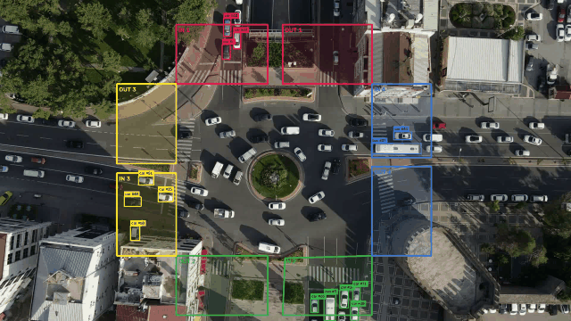

# Computer Vision Learning & Projects

My collection of Python computer vision learning notebooks, coursework, and projects.

## Learning

### 1. Image classification

Explore image classification on CIFAR-10 using PyTorch and Torchvision. The notebook loads and normalizes the dataset, prepares training and test data loaders, and builds a convolutional neural network for ten image classes.

The model uses two convolutional layers with ReLU activations and max pooling, followed by three fully connected layers. Training runs for 30 epochs using cross-entropy loss and stochastic gradient descent with momentum. The notebook currently reports training loss; test-set evaluation has not yet been added.

### 2. Object tracking

A work-in-progress script for exploring webcam-based tracking. It configures Lucas–Kanade optical-flow and feature-detection parameters, captures frames from webcam index `0`, and converts them to grayscale. Optical-flow updates, trajectory drawing, and centroid tracking are not yet implemented.

## Projects

### 1. Vehicle detection and direction tracking

Detect and track vehicles in a traffic video using YOLO and ByteTrack. Four pairs of colored `IN` and `OUT` zones mark traffic directions. Once a tracked object's center enters an `IN` zone, its bounding box, ID label, and movement trail use that zone's color.

[Vehicle tracking project files](projects/vehicle-detection-tracking/)

### 2. Poker hand recognition

Recognize playing cards from a webcam feed using a custom YOLO model. The app draws card labels and confidence scores, then evaluates the poker hand when exactly five distinct cards meet the confidence threshold of 0.5 in a frame.

[Poker project files](projects/poker-hand/)

